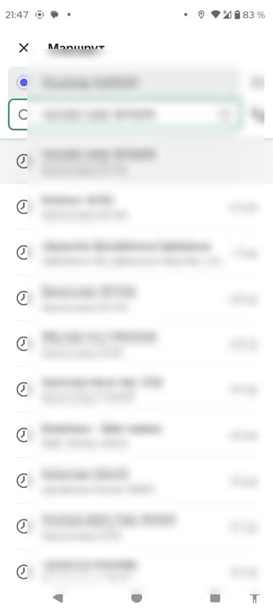

# Marshrut qidiruvi / Route search

> Bolt rasmlari faqat muhokama uchun namuna; Max o'z brendini saqlaydi. Shaxsiy ma'lumotlar xiralashtirilgan.

| Bolt (namuna) | Max (hozir) |
|---|---|
|   Qayerdan/Qayerga maydonlari, oxirgi manzillar ro'yxati, masofa ko'rsatkichi, manzillarni almashtirish tugmasi. | Max'da marshrut qidiruvi alohida varaq (sheet) sifatida ochiladi, lekin oxirgi manzillar va masofa ko'rsatkichi Bolt'dagidek tartibli emas. |

## Savollar

1. Oxirgi manzillar ro'yxatida masofa (km) ko'rsatish foydalimi?
2. Oraliq bekat qo'shish (+) tugmasi yuqorida turishi qulaymi?
3. O'zbekcha manzil nomlari uzun bo'lsa, qanday qisqartirish kerak?

Fikringizni shu mavzudagi **issue**'ga yozing yoki yangi issue oching.

---

## English

> Bolt images are reference only for discussion; Max keeps its own brand. Personal data is blurred.

**Bolt (reference):** From/To fields, recent addresses list, distance indicator, swap-addresses button.

**Max (now):** Max opens route search as a separate sheet, but the recent addresses and distance indicator are not as clean as in Bolt.

### Questions

1. Is showing distance (km) in the recent addresses list useful?
2. Is the add-stop (+) button convenient at the top?
3. How should long Uzbek address names be shortened?

Please share your feedback in the matching **issue** or open a new one.
