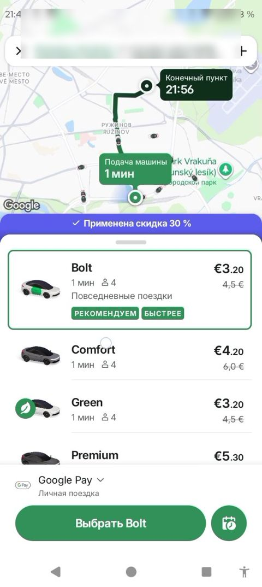

# Xarita va marshrut paneli / Map and route panel

> Bolt rasmlari faqat muhokama uchun namuna; Max o'z brendini saqlaydi. Shaxsiy ma'lumotlar xiralashtirilgan.

| Bolt (namuna) | Max (hozir) |
|---|---|
|   Xaritada marshrut chizig'i, "Haydovchi yetib kelish vaqti" va "Yetib borish vaqti" pufaklari, yuqorida qisqa marshrut paneli. | Max'da marshrut chiziladi, ammo vaqt pufaklari va yuqori panel hali Bolt darajasida emas. |

## Savollar

1. Pufaklarda vaqt (21:56) yoki daqiqa (2 daq) — qaysi biri tushunarliroq?
2. Chegirma banneri xarita va tariflar orasida turishi xalaqit beradimi?
3. Tungi rejimda xarita qanday bo'lishi kerak?

Fikringizni shu mavzudagi **issue**'ga yozing yoki yangi issue oching.

---

## English

> Bolt images are reference only for discussion; Max keeps its own brand. Personal data is blurred.

**Bolt (reference):** Route line on the map, driver ETA and arrival-time bubbles, compact route panel at the top.

**Max (now):** Max draws the route, but the time bubbles and top panel are not yet at Bolt level.

### Questions

1. Clock time (21:56) or minutes (2 min) in bubbles — which is clearer?
2. Does the discount banner between map and tariffs get in the way?
3. How should the map look in night mode?

Please share your feedback in the matching **issue** or open a new one.
