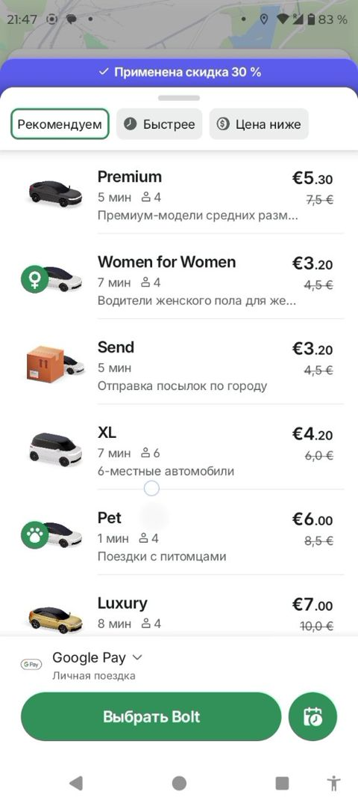

# Tarif varag'i / Tariff sheet

> Bolt rasmlari faqat muhokama uchun namuna; Max o'z brendini saqlaydi. Shaxsiy ma'lumotlar xiralashtirilgan.

| Bolt (namuna) | Max (hozir) |
|---|---|
|   Tariflar ro'yxati: rasm, nom, kutish vaqti, o'rinlar soni, narx va eski narx; yuqorida saralash tablari; pastda to'lov usuli va katta "Tanlash" tugmasi. | Max'da tariflar bor, lekin saralash tablari va eski/yangi narx ko'rinishi yo'q. |

## Savollar

1. "Tavsiya etilgan / Tezroq / Arzonroq" tablari kerakmi?
2. Har bir tarif ostida qisqa izoh (masalan, "Yangi avtomobillar") foydalimi?
3. Narx so'mda qanday yozilsin: "25 000 so'm" yoki "25 ming"?

Fikringizni shu mavzudagi **issue**'ga yozing yoki yangi issue oching.

---

## English

> Bolt images are reference only for discussion; Max keeps its own brand. Personal data is blurred.

**Bolt (reference):** Tariff list: image, name, ETA, seats, price and old price; sort tabs at the top; payment method and a large "Select" button at the bottom.

**Max (now):** Max has tariffs, but no sort tabs and no old/new price display.

### Questions

1. Are "Recommended / Faster / Cheaper" tabs needed?
2. Is a short caption under each tariff (e.g. "New cars") useful?
3. How should prices in UZS be written: "25 000 so'm" or "25k"?

Please share your feedback in the matching **issue** or open a new one.
