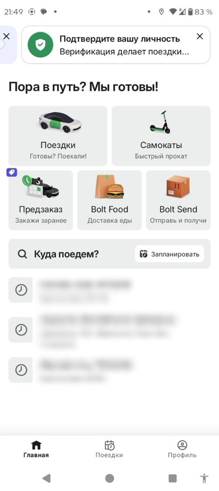

# Yo'lovchi asosiy ekrani (hub)

> Bolt rasmlari faqat muhokama uchun namuna; Max o'z brendini saqlaydi. Shaxsiy ma'lumotlar xiralashtirilgan.

| Bolt (namuna) | Max (hozir) |
|---|---|
|   Katta xizmat kartalari (Safar, Samokat, Oldindan buyurtma, Ovqat, Yuborish), "Qayerga boramiz?" qidiruvi, oxirgi manzillar, pastki menyu. | Max'da ham xizmatlar kartalari bor (taksi, ovqat, yuk), lekin joylashuv va o'lchamlar Bolt'dagidek bir xil emas. |

## Savollar

1. Max uchun qaysi xizmatlar birinchi qatorda turishi kerak?
2. "Rejalashtirish" tugmasi qidiruv ichida qulaymi?
3. Pastki menyuda 3 ta bo'lim yetarlimi?

Fikringizni shu mavzudagi **issue**'ga yozing yoki yangi issue oching.
