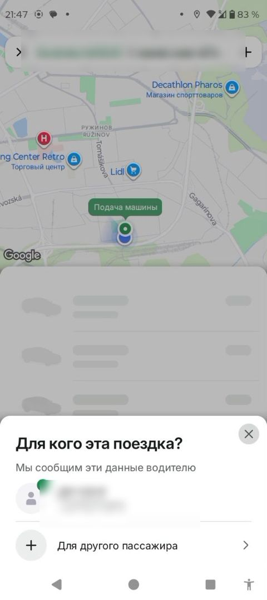

# "Bu safar kim uchun?" varag'i / "Who is this ride for?" sheet

> Bolt rasmlari faqat muhokama uchun namuna; Max o'z brendini saqlaydi. Shaxsiy ma'lumotlar xiralashtirilgan.

| Bolt (namuna) | Max (hozir) |
|---|---|
|   Buyurtmadan oldin: "Men uchun" yoki "Boshqa yo'lovchi uchun". | Max'da bu varaq qo'shildi (Men / Boshqa, ism va telefon). Fikringiz kerak. |

## Savollar

1. Boshqa odam uchun buyurtmada qaysi ma'lumotlar majburiy bo'lishi kerak?
2. Kontaktlardan tanlash imkoniyati kerakmi?
3. Haydovchiga yo'lovchi ismi ko'rsatilsinmi?

Fikringizni shu mavzudagi **issue**'ga yozing yoki yangi issue oching.

---

## English

> Bolt images are reference only for discussion; Max keeps its own brand. Personal data is blurred.

**Bolt (reference):** Before ordering: "For me" or "For another passenger".

**Max (now):** Max now has this sheet (Me / Someone else, name and phone). Feedback needed.

### Questions

1. Which details should be required when ordering for someone else?
2. Is picking from contacts needed?
3. Should the driver see the passenger's name?

Please share your feedback in the matching **issue** or open a new one.
