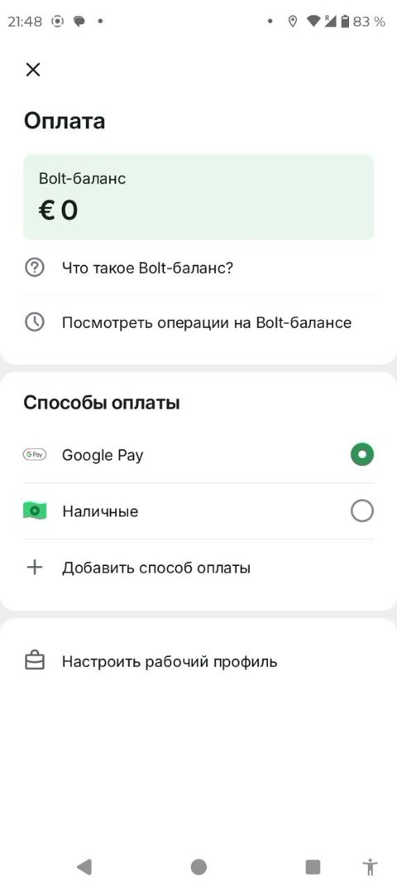

# To'lov varag'i / Payment sheet

> Bolt rasmlari faqat muhokama uchun namuna; Max o'z brendini saqlaydi. Shaxsiy ma'lumotlar xiralashtirilgan.

| Bolt (namuna) | Max (hozir) |
|---|---|
|   Balans kartasi, to'lov usullari (radio tugmalar), "To'lov usuli qo'shish". | Max'da balans kartasi va radio usullar qo'shildi; Google Pay olib tashlandi (O'zbekistonda yo'q). |

## Savollar

1. Naqd, karta (Payme/Click) va balans — qaysi tartibda turishi kerak?
2. Balans to'ldirish tugmasi shu yerda bo'lishi kerakmi?
3. Ish profili (korporativ to'lov) kerakmi?

Fikringizni shu mavzudagi **issue**'ga yozing yoki yangi issue oching.

---

## English

> Bolt images are reference only for discussion; Max keeps its own brand. Personal data is blurred.

**Bolt (reference):** Balance card, payment methods (radio buttons), "Add payment method".

**Max (now):** Max added a balance card and radio methods; Google Pay was removed (not available in Uzbekistan).

### Questions

1. Cash, card (Payme/Click) and balance — in what order?
2. Should a top-up button be here?
3. Is a work profile (corporate payment) needed?

Please share your feedback in the matching **issue** or open a new one.
