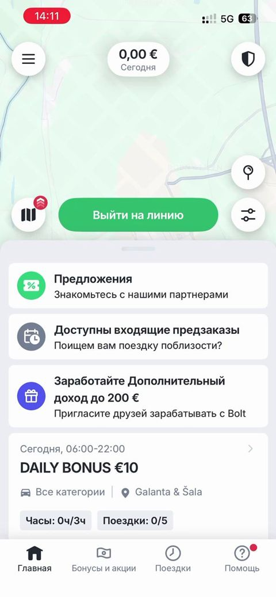

# Haydovchi asosiy ekrani va oldindan buyurtmalar

> Bolt rasmlari faqat muhokama uchun namuna; Max o'z brendini saqlaydi. Shaxsiy ma'lumotlar xiralashtirilgan.

| Bolt (namuna) | Max (hozir) |
|---|---|
|   Yuqorida bugungi daromad, katta "Liniyaga chiqish" tugmasi, pastda takliflar, oldindan buyurtmalar va bonus kartalari. | Max haydovchi menyusida "Oldindan buyurtmalar", "Do'stni taklif qilish" va "Maxfiylik" qo'shildi. |

## Savollar

1. Bonus kartasi (masalan, "5 ta safar — bonus") Max'da kerakmi?
2. "Liniyaga chiqish" tugmasi rangi va o'rni qulaymi?
3. Haydovchi uchun eng muhim 3 ta ma'lumot qaysi?

Fikringizni shu mavzudagi **issue**'ga yozing yoki yangi issue oching.
