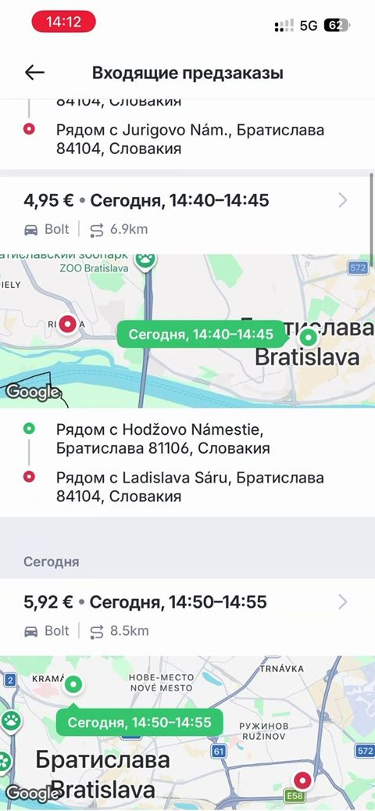

# Rejalashtirilgan safarlar (tablar)

> Bolt rasmlari faqat muhokama uchun namuna; Max o'z brendini saqlaydi. Shaxsiy ma'lumotlar xiralashtirilgan.

| Bolt (namuna) | Max (hozir) |
|---|---|
|   Kiruvchi oldindan buyurtmalar: narx, vaqt oralig'i, masofa, kichik xarita va manzillar. | Max'da ScheduledRidesPage bor, lekin tablar (Kiruvchi / Qabul qilingan) va kartalar dizayni hali tayyor emas. |

## Savollar

1. Har bir kartada kichik xarita kerakmi yoki faqat manzillar yetarlimi?
2. Tablar qanday nomlansin?
3. Vaqt oralig'i (14:40–14:45) tushunarlimi?

Fikringizni shu mavzudagi **issue**'ga yozing yoki yangi issue oching.
