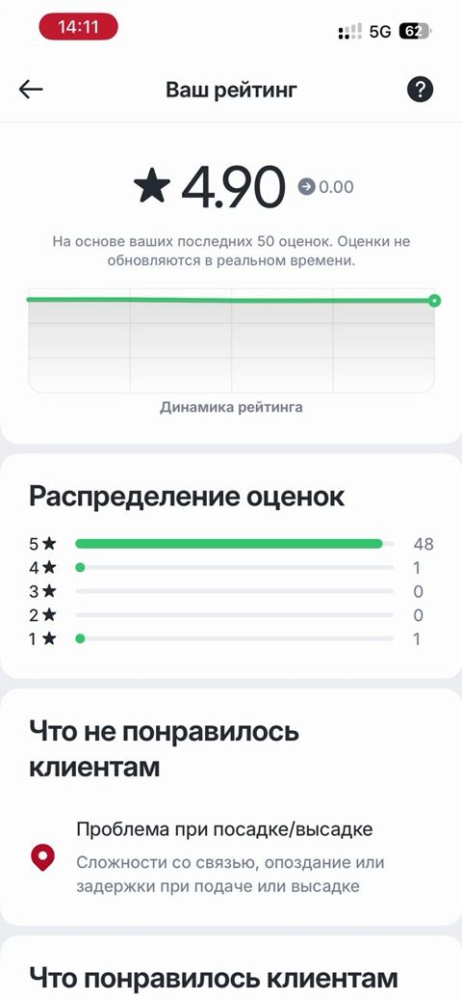

# Haydovchi reytingi va sabablar / Driver rating and reasons

> Bolt rasmlari faqat muhokama uchun namuna; Max o'z brendini saqlaydi. Shaxsiy ma'lumotlar xiralashtirilgan.

| Bolt (namuna) | Max (hozir) |
|---|---|
|   Katta reyting raqami, dinamika grafigi, baholar taqsimoti, "Mijozlarga nima yoqmadi / yoqdi" sabablari. | Max'da reyting raqami bor, sabablar bo'limi hali yo'q. |

## Savollar

1. Qaysi sabablar ro'yxatda bo'lishi kerak (o'zbek sharoitida)?
2. Grafik haydovchi uchun foydalimi?
3. Yomon baho sababini haydovchi ko'rishi adolatlimi?

Fikringizni shu mavzudagi **issue**'ga yozing yoki yangi issue oching.

---

## English

> Bolt images are reference only for discussion; Max keeps its own brand. Personal data is blurred.

**Bolt (reference):** Large rating number, trend chart, rating distribution, "What customers disliked / liked" reasons.

**Max (now):** Max shows the rating number; the reasons section does not exist yet.

### Questions

1. Which reasons should be on the list (for Uzbekistan)?
2. Is the chart useful for drivers?
3. Is it fair for a driver to see the reason for a low rating?

Please share your feedback in the matching **issue** or open a new one.
