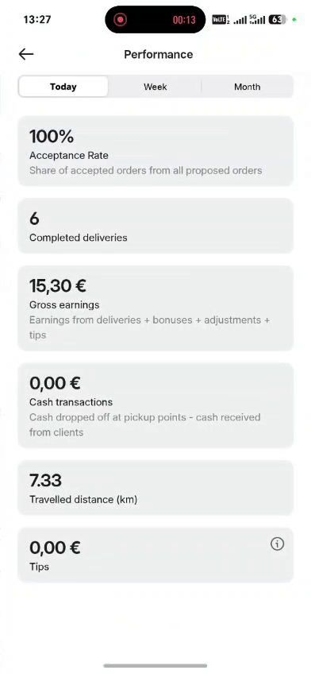

# Kuryer "Ko'rsatkichlar" / Courier "Performance"

> Bolt rasmlari faqat muhokama uchun namuna; Max o'z brendini saqlaydi. Shaxsiy ma'lumotlar xiralashtirilgan.

| Bolt (namuna) | Max (hozir) |
|---|---|
|   Bugun / Hafta / Oy: qabul qilish foizi, yetkazmalar soni, daromad, naqd, masofa, choy puli. | Max'da bu sahifa hali yo'q. |

## Savollar

1. Qabul qilish foizi kuryerni bosim ostida qoldiradimi?
2. Qaysi ko'rsatkichlar eng muhim?
3. Choy puli alohida bo'lishi kerakmi?

Fikringizni shu mavzudagi **issue**'ga yozing yoki yangi issue oching.

---

## English

> Bolt images are reference only for discussion; Max keeps its own brand. Personal data is blurred.

**Bolt (reference):** Today / Week / Month: acceptance rate, deliveries, earnings, cash, distance, tips.

**Max (now):** Max does not have this page yet.

### Questions

1. Does acceptance rate put too much pressure on couriers?
2. Which metrics matter most?
3. Should tips be shown separately?

Please share your feedback in the matching **issue** or open a new one.
