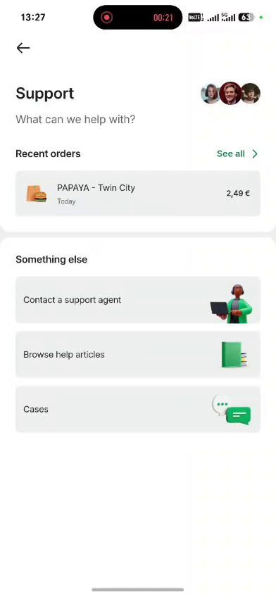

# Yordam (Support) / Support

> Bolt rasmlari faqat muhokama uchun namuna; Max o'z brendini saqlaydi. Shaxsiy ma'lumotlar xiralashtirilgan.

| Bolt (namuna) | Max (hozir) |
|---|---|
|   Oxirgi buyurtmalar, "Operator bilan bog'lanish", "Yordam maqolalari", "Murojaatlar". | Max'da yordam bo'limi oddiy; murojaatlar (tiket) tizimi rejada. |

## Savollar

1. Telegram orqali yordam qulayroqmi yoki ilova ichidagi chat?
2. Qaysi yordam maqolalari birinchi kerak?
3. Javob kutish vaqtini ko'rsatish kerakmi?

Fikringizni shu mavzudagi **issue**'ga yozing yoki yangi issue oching.

---

## English

> Bolt images are reference only for discussion; Max keeps its own brand. Personal data is blurred.

**Bolt (reference):** Recent orders, "Contact a support agent", "Help articles", "Cases".

**Max (now):** Max support is basic; a ticket system is planned.

### Questions

1. Is Telegram support more convenient than in-app chat?
2. Which help articles are needed first?
3. Should expected response time be shown?

Please share your feedback in the matching **issue** or open a new one.
